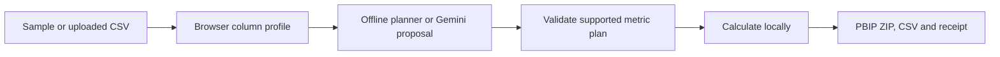

# Agentic BI Builder

A workflow profiles one data file, uses AI to propose business metrics, checks calculations and generates editable Power BI project files.

## The problem

Starting a business-intelligence report means inspecting a dataset, choosing useful measures, writing calculations and building the report structure. I wanted to explore which parts an AI-assisted workflow could handle while keeping its suggestions checkable.

## What I built

I implemented the workflow, its typed data contracts, query execution, report compiler and tests. A typed contract defines the fields and values each step must provide. The compiler converts supported query patterns into Power BI's report and data-model files. Unsupported calculations are rejected rather than guessed.

Mentor review and hardening contributions are retained in Git history. This is mentored individual implementation, not evidence that I wrote every supporting line without help.

I also maintain a smaller static browser demo for CSV uploads, online metric planning or offline simulation, local calculations and project downloads. The public version demonstrates the constrained flow rather than the whole Python application.

## Architecture


This diagram describes the Python workflow. SQL is Structured Query Language, used to query the temporary SQLite database. LangGraph connects the workflow steps and limits the repair path to one retry; Pydantic checks the structured responses at step boundaries. The browser version asks for a restricted metric plan, not SQL, and calculates it directly in JavaScript.



## How it works

In Python, the profiler identifies columns and types. The AI proposes key performance indicators (KPIs) with SQL queries. SQLite executes them; the review step can request one repair before supported calculations are compiled into Power BI report and data-model files. A rejected build exits with an explicit status and records its summary.

In the browser, the workflow inspects the CSV, infers or requests a restricted metric plan from its columns, validate it, calculate from the actual rows and export a new project. Online failure remains an error; offline simulation is an explicit mode.

## ML / AI methodology

This is applied AI orchestration, not a trained predictive model. Gemini or Mistral proposes metrics in the Python path; Gemini provides the browser's online plan. Deterministic schemas and calculation checks constrain accepted output. The offline planner and stored specifications offer repeatable engineering comparisons, not a measured benchmark of AI quality.

Python proposals use column metadata; the reviewer also receives sampled query results. Browser planning sends the disclosed column metadata, never CSV rows. Provider calls in automated tests are mocked. No labeled metric-quality benchmark, general hallucination rate, time-saving study or verified successful visitor-key run is claimed.

## Engineering

LangGraph connects the Python steps and enforces the repair budget. Pydantic validates their typed contracts. SQLite executes real queries; the compiler generates supported report structures, DAX measures (Power BI calculations) and TMDL files (the text definition of its data model). Automated tests exercise workflow routing, accepted and rejected builds, calculations, report structure and command exit behavior.

The browser is static HTML/JavaScript, with CSV parsing, plan validation, calculations and ZIP export. There is no free-text prompt step: the original workflow infers metrics from the dataset profile. Its key is sent directly to Google, is never persisted and is cleared after a run. No app-owned backend or shared provider key is required. A Python CI workflow exists; account billing limits remain unchanged, and this release does not claim a green remote run.

## Results

The last full verified suite passed 264 tests with demo dependencies installed. A focused follow-up passed 30 demo and end-to-end tests after the public-evidence/provenance edits. These checks cover real query execution, rejected/accepted builds, report structure, workflow routing and command exit behavior. Provider calls in tests are mocked: controlled substitute responses exercise the software mechanics, not the model's quality.

The earlier fictional evidence export passed through the Python profiler, SQLite executor and report compiler. The interactive browser demo has its own local calculation and export implementation. Its 15 browser tests pass and exercise calculations, rejected plans and controlled provider responses. Generated ZIP contents and report JSON schemas were checked independently; browser testing covered sample/uploaded CSV builds, downloads and invalid-key handling. A browser-to-Google connection preflight was checked, but I have not verified a successful live generation using a valid visitor key. These checks do not establish AI metric quality or a fresh Power BI Desktop opening.

Historical AI-run artifacts are in [the evidence bundle](evidence/v1/README.md). They differ from deterministic replays and reconstructed fixtures. Provider/model identities were not retained for some historical runs, and the HR fixture is a reconstruction rather than saved provider output. Historical screenshots remain illustrations of their recorded runs; they are not new Desktop verification.

The browser sample contains **12 fictional invoices**. Independently checked sample revenue is **258**, split between Ghana (**135**) and Kenya (**123**), with an average of **3 tracks** per invoice. These are test-data calculations, not business impact. The browser supports **four to eight metrics** per plan; its calculation tests and downloads are distinct from Python workflow tests.

## Demo

[Build a report in the public demo](https://tessa-agentic-bi-evidence.purple-tick-2127.chatgpt.site).

Use the 12 fictional sample invoices or upload your own CSV, then build and inspect a report. A CSV is a table stored as a text file. There are two modes:

- **Without a key:** the browser chooses a simple report plan and calculates it from your data. This is a deterministic simulation: the same input produces the same plan and results, without an AI call.
- **With your Gemini key:** Google proposes the metrics, then the browser checks the plan, calculates the results and builds the project. Your provider account's usage limits and charges apply. A failed online request is shown as an error; it is not silently replaced with a simulation.

Both modes download an editable Power BI Project (`.pbip`) ZIP, the actual input CSV and a run receipt containing the plan and calculated results. Right-click the ZIP and choose **Extract All**, then run the included `prepare_report.ps1` in PowerShell to set the CSV path (or use the manual path instructions). Open the extracted `BrowserDemo.pbip` in Windows Power BI Desktop and refresh. These are project source files, not a ready-made `.pbix` report. Do not open the `.pbip` from inside the ZIP: its report and semantic-model folders must be extracted alongside it. I have not freshly opened the browser-generated output in Desktop.

I built this browser version so someone can try the idea without installing Python or signing in to my service. It supports one table, four to eight metrics and a fixed set of calculations. It is a smaller implementation than the Python workflow below, rather than a browser port of its full AI review workflow. The sample is fictional data, not the Chinook dataset used by the local examples. The source repository is now public.

The CSV stays in your browser. Online planning sends Google column metadata: names, types, missing-value counts, distinct-value counts and row count. It sends no row samples or minimum/maximum values. Column names and counts can still be sensitive. The key goes directly to Google in a request header, is never saved and is cleared after each run. See [browser-demo setup and limits](web-demo/README.md).

## Run locally

For the browser demo, serve the static files from the repository root:

```bash
python -m http.server 8000 --directory web-demo
```

Open `http://localhost:8000`. No backend or app-owned API key is needed. Online mode calls Google directly with the visitor's key. Hosting the full Python workflow on the same execution path would require a Python backend.

For the full Python workflow, supported versions are 3.10–3.12. The latest Windows verification used Python 3.12.0:

```bash
python -m venv .venv
# Activate the environment for your operating system.
python -m pip install -r requirements.txt
python -m pip install -r requirements-demo.txt
python -m pytest -q
python -m streamlit run app.py
```

The Streamlit app is a local web interface for the deterministic path: it uses stored metric specifications, executes their queries and compiles a downloadable project. It requires no API key. Base dependencies alone run 261 tests and skip the three optional interface tests; demo dependencies enable all 264.

To run the AI proposal/review steps, copy `.env.example` to `.env`, configure your Gemini or Mistral key, then run:

```bash
python run_agent.py --input data/raw/chinook.csv --output output/chinook_report
```

Live-provider calls require your provider account and may incur its normal usage charges.

## Repository structure

- `agent/`: profiling, provider clients, query execution and review graph.
- `pbir/`: report/data-model contracts and compiler.
- `web-demo/`: hosted browser demo, sample and browser tests.
- `app.py`, `demo_core.py`: offline Streamlit interface and deterministic core.
- `run_agent.py`, `scripts/`: command-line runs and evidence tools.
- `evidence/v1/`, `assets/`: provenance-labeled records and historical illustrations.
- `tests/`, `docs/`: regression checks and file-format reference.

See [STRUCTURE.md](STRUCTURE.md) for the detailed tree and [compiler reference](docs/pbir_reference.md) for format constraints.

## Limitations

- One table at a time; no joins between tables. Python SQL is validated for SQLite. The browser accepts supported metric operations rather than arbitrary queries.
- The Python report compiler supports a declared set of aggregate/query shapes and four visual types. A build with fewer than four usable visuals is rejected. The browser supports four to eight metrics using sum, average, count, minimum, maximum or distinct count, displayed as cards, bars, lines or tables.
- Proposed metrics must still make business sense. A valid query does not prove a useful metric or a reliable AI reviewer.
- Python metric generation receives column metadata; its review step receives sampled result rows. The whole Python live workflow is not metadata-only. The browser's online planner sends only the disclosed metadata.
- Output is a Power BI Project (`.pbip`), a folder of report/model files. Windows and Power BI Desktop are needed to open it. The compiled model contains an absolute CSV path; relocate that path or keep the input at the documented location, then refresh. See the public example's explicit download instructions.
- No Power BI Service deployment, production adoption, multi-user service or general reflection-success rate is claimed.

This is a mentored portfolio prototype without established production adoption or measured business time savings. Historical provider identities are incomplete and reconstructed fixtures remain labeled. Successful live generation with a valid browser key and fresh Power BI Desktop rendering remain unverified.

## What I would improve next

1. Record a successful live-key run and verify its generated project in Power BI Desktop.
2. Add a small labeled set of useful metrics and expected values to evaluate AI proposals.
3. Improve portable CSV paths and explain unsupported calculations at the point of export.

## My contribution

I designed and implemented the main workflow, profiler, provider integration, query execution, report compiler, tests and documentation under mentorship. Mentor Adeyeri Michael contributed review, scaffolding and specific validation hardening; I do not claim sole authorship of those changes. Later browser and portfolio repairs were completed with AI assistance, separate from the original authored implementation history.
