# Agentic BI Builder

> A LangGraph-powered analytics agent that profiles a structured dataset, proposes relevant KPIs, generates and validates SQL queries, reflects on its own outputs, and compiles a real Power BI Project (.pbip) folder, ready to open directly in Power BI Desktop.

**Scope (v1):** single-table CSV/SQLite input → typed LangGraph workflow → LLM-proposed KPIs with SQL → real SQLite execution → one bounded self-reflection retry → deterministic Power BI Project (`.pbip`) output. Windows + Power BI Desktop are required to open that output. No multi-table joins, no Power BI Service publishing, no hosted service, no production deployment — see [Known Limitations and Stretch Goals](#known-limitations-and-stretch-goals).

**At a glance**

- **What it is:** a bounded v1 prototype — a CLI agent plus a custom PBIR/TMDL compiler, 264 tests, a committed [evidence bundle](evidence/v1/), and a solo implementation under structured mentorship ([credits](#what-i-built--credits)).
- **Input:** one CSV (or SQLite) file, single table, SQLite SQL dialect only.
- **SQL→DAX:** a regex translator over a bounded set of measure shapes; anything outside it fails closed (the KPI is dropped, and a report with fewer than 4 translatable visuals is rejected outright).
- **Output:** a `.pbip` folder that opens in **Power BI Desktop for Windows** and embeds the compiling machine's absolute CSV path.
- **What it is not:** a production system, a hosted API, a multi-user tool, or an "autonomous data analyst."

---

## Problem Statement

Starting a BI project from a new dataset involves hours of repetitive scaffolding work: inspecting the schema, deciding which metrics matter, writing aggregation queries, and manually mapping results into a dashboard layout. This process is largely mechanical, yet it still requires enough domain inference (recognising that a dataset is a music retailer versus an HR system, for instance) that it can't be reduced to a fixed template or a set of simple rules.

This project explores whether a LangGraph-based agentic system can automate that entire setup phase end to end: taking a raw CSV as input and producing a working Power BI report as output, without a human deciding which metrics matter or hand-writing a single query. The agent profiles the data deterministically, infers a business domain and proposes KPIs with an LLM, executes and validates the resulting SQL against real data, reflects on its own output to catch and fix mistakes, and compiles the validated results into a genuine `.pbip` project that opens natively in Power BI Desktop.

---

## Architecture


```
CSV input
    │
    ▼
┌─────────────────────────────────────────────────────────┐
│                    LANGGRAPH AGENT                      │
│                                                         │
│  Profiler ──▶ Domain/KPI Node ──▶ SQL Executor          │
│  (Pandas)      (LLM + Pydantic)    (SQLite)             │
│                                         │               │
│                                         ▼               │
│  PBIR Compiler ◀── Reflector ◀── Validation check       │
│  (Python)          (LLM)                                │
└─────────────────────────────────────────────────────────┘
    │
    ▼
.pbip folder → open in Power BI Desktop
```

## Design Decisions

A few choices are worth calling out explicitly, because they are the difference between "an agent that runs" and "an agent whose behaviour you can predict":

- **LangGraph for topology, not for agents.** The graph's topology *enforces* the one-retry policy — `sql_executor_retry` has exactly one outgoing edge, straight to the PBIR compiler, so there is no path back to the reflector — rather than enforcing it with a counter in state that any node could accidentally mutate. The retry budget is load-bearing, not conventional, and `tests/test_graph.py` asserts the wiring so a future edit cannot silently create a loop.
- **Pydantic + provider-native structured output.** LLM responses are validated against typed models (`KPISpec`, `DomainKPIResponse`, `ReflectionNote`) using each provider's native schema mechanism (Gemini `response_schema`, Mistral `chat.parse(response_format=…)`), not LangChain output parsers or regex-on-text. A malformed response is a validation error at the boundary, not a mystery three nodes later. This is also why `langchain-*` appeared as an unused dependency in older revisions and has been removed.
- **Regex SQL→DAX over a full parser.** The translator recognises a bounded family of SQL shapes built from five DAX primitives (`SUM`, `AVERAGE`, `COUNT`, `DIVIDE`, `IF`) — plain aggregates, `COUNT(*)`, `ROUND(...)`, ratios, row-wise products (`SUM(a*b)` → `SUMX`), `COUNT(DISTINCT …)` → `DISTINCTCOUNT`, grouped chart queries, the conditional-percentage `CASE WHEN` idiom, and single-condition `WHERE` filters — and **fails closed** on anything else. A full SQL parser (e.g. `sqlglot`) would broaden support but also mask failures; failing closed keeps an unsupported KPI visible to the user instead of silently mistranslated into plausible-looking DAX. For a v1 with declared scope, that trade is worth more than coverage.
- **Metadata-only at KPI-proposal time; sampled rows at reflection time.** The domain/KPI prompt sends schema metadata (column names, inferred types, null rates, distinct counts) but deliberately strips sample values and min/max, to reduce the data-exposure surface and improve output stability. The reflector *does* see up to 10 sampled result rows per KPI (`MAX_ROWS_IN_PROMPT`, on top of the 20-row storage cap in `QueryResult`), because reviewing numbers requires seeing numbers. The split is deliberate and tested — see `tests/test_domain_kpi.py::test_excludes_sample_values`.
- **In-memory SQLite for execution.** Nothing persists: every run loads the CSV into a fresh in-memory instance. Execution is deterministic, sandboxed, and free of cleanup state, at the cost of no cross-run memory. It also makes the LLM's SQL safe to run — the only thing it can touch is a throwaway table named `data`.
- **Fail-open per KPI, fail-closed per build.** A single KPI that cannot be translated, or that still fails after its one retry, is dropped with an error entry rather than crashing the run; but a report that ends up with fewer than 4 translatable visuals (`MIN_VISUALS_REQUIRED`) is **rejected entirely** rather than shipped as a silently thin dashboard. Partial useful output beats deceptive emptiness — and an empty-ish report is exactly what a demo should refuse to produce.

---

## Demo


*Terminal run of `run_agent.py` against the Chinook dataset: profiling, then KPI generation, SQL execution, reflection, and compile, followed by opening the resulting `.pbip` in Power BI Desktop.*

### Try it without an API key

`app.py` is a Streamlit app that runs the **deterministic half** of the pipeline — profiler → committed KPI specs → real SQLite execution → PBIR/TMDL compilation → downloadable `.pbip` — for all three datasets. It makes no LLM calls (it never imports the LLM layer, which `tests/test_demo_app.py` asserts mechanically), so it needs no keys and no network:

```bash
pip install -r requirements-demo.txt
streamlit run app.py
```

The KPI specs it compiles are the committed fixtures in `tests/fixtures/kpis/` — real provider output from a recorded run, the same fixtures the no-network regression tests use — so the demo shows what the agent's validated output actually becomes on disk: the `.pbip` it hands you is the same artifact `run_agent.py` writes for those specs, with the one machine-specific part being the absolute CSV path embedded in the M partition. Opening the result requires Power BI Desktop on Windows (see [Report path coupling](#known-limitations-and-stretch-goals)).

**Public URL:** the demo is written to deploy on Streamlit Community Cloud (`.streamlit/config.toml` included, no secrets required); the deployed link will be recorded here and in `FLAGSHIP_VERIFICATION_CHECKLIST.md` once the app is published. Until then, run it locally with the two commands above.

---

## Quickstart

```bash
git clone https://github.com/Tessa-Saumu/Agentic-BI-Builder
cd Agentic-BI-Builder

python -m venv .venv
source .venv/bin/activate        # .venv\Scripts\activate on Windows

pip install -r requirements.txt  # add -r requirements-demo.txt for the Streamlit demo

cp .env.example .env             # add GEMINI_API_KEY and/or MISTRAL_API_KEY
                                  # set LLM_PROVIDER=gemini or mistral

python run_agent.py --input data/raw/chinook.csv --output output/chinook_report
```

Then open `output/chinook_report/chinook.pbip` in Power BI Desktop (Windows). The
`.pbip` filename comes from the input dataset, so it is `online_retail.pbip` and
`hr_analytics.pbip` for the other two.

The other two reference datasets run the same way:

```bash
python run_agent.py --input data/raw/online_retail.csv --output output/online_retail_report
python run_agent.py --input data/raw/hr_analytics.csv --output output/hr_report
```

**What you will see.** Each node prints as it runs (profile written, KPIs
written, per-KPI SQL pass/fail, reflection verdict), then:

```
[PBIR Compiler] Writing .pbip folder to 'output/chinook_report'...
✅ Report written to: output/chinook_report (2 page(s), 5 visual(s))
Note: compiled report embeds the absolute CSV path; to move the report to another machine, re-run run_agent.py there.

--- Timing ---
  profiler            0.03s
  domain_kpi         10.91s
  sql_executor        0.02s
  reflector           1.59s
  pbir_compiler       0.00s
  TOTAL              12.55s

--- Reflection ---
  No issues found. All 5 KPI(s) passed review as-is.
```

(Timings above are the recorded Mistral/Chinook run; LLM nodes dominate and
vary by provider — see [Per-Node Timing](#per-node-timing).) Alongside the
`.pbip` folder the run writes `output/chinook_report/run_summary.json` (machine-readable:
KPI names kept/dropped, per-node timings, errors, page/visual counts, provider,
model, temperature, package versions) and `data/profiles/chinook_{profile,kpis}.json`.
Exit code is `0` on a written report with no errors and `1` otherwise.

No API key? Run the deterministic demo instead — see
[Try it without an API key](#try-it-without-an-api-key).

---

## Agent Nodes

| Node | Type | What it does |
|---|---|---|
| Profiler | Deterministic | Pandas-based schema analysis: column types, null rates, distinct counts, sample values |
| Domain/KPI | LLM | Infers business domain (retail, HR, finance, etc.) and proposes 5 KPIs with SQL, chart type, and reasoning |
| SQL Executor | Deterministic | Loads the CSV into SQLite, runs each KPI query, captures results and errors |
| Reflector | LLM | Reviews profile + KPI list + results in a single call, flags mismatches (wrong aggregations, null-heavy columns, implausible values, SQL errors), and returns corrected SQL for each flagged KPI |
| SQL Executor (retry) | Deterministic | Re-runs only the KPIs the Reflector flagged, using the fix it supplied, exactly once per KPI, then drops any KPI still failing |
| PBIR Compiler | Deterministic | Maps validated query results to Pydantic PBIR models and writes the `.pbip` folder structure |

The retry is a property of the graph's topology rather than a counter in state: the retry-executor node has exactly one outgoing edge, straight to the PBIR Compiler, so a second reflection pass can never fire for the same KPI.

---

## PBIR Output Structure

The agent emits a valid Power BI Project: two independent "documents," `<name>.Report/` and `<name>.SemanticModel/`, linked only by a relative path in `<name>.Report/definition.pbir`. Power BI Desktop opens the root `.pbip` file directly.

```
<name>.pbip                          # root pointer file
<name>.Report/
├── definition.pbir                  # points Report -> SemanticModel
└── definition/
    ├── report.json                  # theme + report-level settings
    ├── version.json                 # schema version pin
    └── pages/
        ├── pages.json               # page order + active page
        └── <pageId>/
            ├── page.json            # one per page
            └── visuals/
                └── <visualId>/
                    └── visual.json  # one per visual (field bindings, chart type)

<name>.SemanticModel/
└── definition/
    ├── database.tmdl                # fixed, 2 lines
    ├── model.tmdl                   # table references
    └── tables/
        └── <table>.tmdl             # schema + M query + DAX measures, the core dynamic file
```

(`.platform` metadata files, theme resources, and Desktop-owned cache files also exist on disk but are omitted above since the compiler either copies them verbatim as fixed templates or never writes them at all.)

Each `<table>.tmdl` is where a KPI actually becomes a Power BI artifact: one `measure` block per KPI holding its DAX expression, one `column` block per source column, and a `partition` block whose `source` is the Power Query M script that loads the CSV at Desktop open or refresh time. There is no separate "data model" JSON file or "connections" file; the model schema, the DAX measures, and the data-source connection are all part of this one TMDL file per table. This structure is reverse-engineered from a real `.pbip` export (see `docs/pbir_reference.md`) and modelled as Pydantic classes for the JSON files plus a dedicated TMDL writer for the SemanticModel side, so the agent populates typed Python objects rather than hand-building either format as raw strings.

For the record: `output/reference_report/` in this repository is the trimmed, hand-curated sample export that the format was reverse-engineered *from*. It is a reference artifact, not pipeline output — nothing in `agent/` or `pbir/` reads or writes it. Everything the pipeline produces lands in `output/<dataset>_report/`.

---

## Tech Stack

| Layer | Tools |
|---|---|
| Agent orchestration | LangGraph |
| LLM | Google Gemini (`gemini-3.5-flash` / `gemini-3.1-pro`) or Mistral AI (`mistral-large-latest` / `mistral-medium-latest`) |
| Data profiling | pandas |
| SQL execution | SQLite (`sqlite3`) |
| Structured outputs | Pydantic, provider-native structured output (no LangChain) |
| PBIR generation | Python (custom PBIR compiler), TMDL |
| Visualisation | Power BI Desktop |
| Version control | Git, GitHub |

`LLM_PROVIDER` switches between `gemini` and `mistral` at runtime via `.env`. Both are used in place of the originally-scoped Anthropic/OpenAI providers to stay on free tiers, confirmed with the mentor before implementation.

---

## What I built / Credits

Agentic BI Builder was implemented by **Theresia (Tessa) Saumu** between June and August 2026 as a solo implementation project under structured mentorship, then consolidated in October 2026 (evidence bundle, verification tests, translator gap closure, this demo). All pipeline nodes (`agent/`), the PBIR/TMDL compiler (`pbir/`), the typed Pydantic models, the driver and validation scripts, the fault-injection harness, the test suite (216 tests at `v1.0.0`; 264 after consolidation), and the 1,129-line PBIR reference document (`docs/pbir_reference.md`) were authored by `Tessa-Saumu` — 123 of the 132 commits on `main` as of 2026-10-07.

Credits to **Adeyeri Michael** ([`Mikehade`](https://github.com/Mikehade)), mentor — 9 of those 132 commits:

- **Review and merges:** merged implementation PRs [#8–#13](https://github.com/Tessa-Saumu/Agentic-BI-Builder/pulls?q=is%3Apr+is%3Amerged) (PBIR reverse-engineering, profiler node, domain/KPI node, SQL executor + reflector nodes, PBIR compiler, full pipeline), with phase and acceptance-criteria review feedback on each. `#14` (final polish) and the `v1.0.0` release tag (2026-08-30) were merged/published by `Tessa-Saumu`.
- **Commit [`cca0106`](https://github.com/Tessa-Saumu/Agentic-BI-Builder/commit/cca0106)** (2026-07-13): KPI-name uniqueness validation in `DomainKPIResponse`; reflector hardening that rejects duplicate KPI/`QueryResult` names before the LLM call and filters out notes referencing unknown KPIs; and the `reviewed_kpi_count` logging fix (the "no issues found across N KPIs" line previously printed `0`). Plus the tests covering all three (`agent/models.py`, `agent/reflector.py`, `tests/test_domain_kpi.py`, `tests/test_reflector.py`).
- **Commit [`55578ac`](https://github.com/Tessa-Saumu/Agentic-BI-Builder/commit/55578ac)** (2026-06-15): early environment and scaffold setup — `.gitignore`, `.env.example`, module stubs for `agent/`, and the Phase-1 scaffold script now preserved (disabled) at `scripts/_scaffold_phase1_reference.sh`.

The phase issues [#1–#7](https://github.com/Tessa-Saumu/Agentic-BI-Builder/issues?q=is%3Aissue+is%3Aclosed) and implementation PRs [#8–#14](https://github.com/Tessa-Saumu/Agentic-BI-Builder/pulls?q=is%3Apr) hold the full design discussion and review history; the open `V2:` issues (#15–#39) are explicitly *planned, not started*.

This is **not** a production system, a product with users, or an autonomous analyst. It is a v1 bounded prototype built to demonstrate applied LLM workflow engineering: typed contracts, real execution as ground truth, a retry budget enforced by graph topology, and a deterministic compiler whose output opens in a real desktop product.

---

## Test Datasets

| Dataset | Domain | Source |
|---|---|---|
| Chinook | Music retail | Public SQLite sample DB |
| Online Retail | E-commerce | UCI ML Repository |
| HR Analytics | Human resources | Kaggle public dataset |

---

## Per-Dataset Results

All three datasets run end-to-end via `run_agent.py` without crashing, under both supported LLM providers, on every KPI (5/5, no drops).

**Provenance of the numbers in this section.** They come from the August 2026 confirmation round (`v1.0.0`, released 2026-08-30), run live against both providers on the developer's machine. Those runs' raw artifacts — KPI JSONs, reflection logs, `.pbip` folders — were not retained, so the tables and timings below are **historical**: reproducible from [Quickstart](#quickstart) with an API key, but not attached as files. What *is* attached is [`evidence/v1/`](evidence/v1/): a traceable bundle of July 2026 development-run artifacts (real KPI specs, sabotaged copies, stress-test reflections, the one organic reflector catch) plus profiles, query results, and run summaries regenerated deterministically on 2026-10-07 under the pinned environment. Its [README](evidence/v1/README.md) states which artifact is which, and documents the single compile-outcome delta against the historical run (Online Retail's `Total Unique Customers`, dropped then, compiled now — see [Failure Modes](#failure-modes-observed-and-fixed)).

| Dataset | Domain Inferred | KPIs Generated | Reflection Fixes | Report Screenshot |
|---|---|---|---|---|
| Chinook | Digital music retail (e-commerce) | 5/5 | None needed on this confirmation run. Reflector correction demonstrated separately via fault-injection stress test (below) | [`gemini_page2_country_trend_artists.png`](assets/chinook/gemini_page2_country_trend_artists.png) |
| Online Retail | E-commerce retail | 5/5 | One organic catch-and-fix during earlier validation (Gemini): a timestamp-granularity issue | [`gemini_page2_country_trend_products.png`](assets/online_retail/gemini_page2_country_trend_products.png) |
| HR Analytics | HR / employee retention and satisfaction | 5/5 | None needed on this confirmation run | [`gemini_page2_department_and_income.png`](assets/hr_analytics/gemini_page2_department_and_income.png) |

The full breakdown below (per-provider KPI lists, timing, and the fault-injection stress test that gives repeatable evidence of the Reflector's correction capability) expands on this summary.

### Chinook

| Provider | Domain Inferred | KPIs Proposed | Reflection | Pages / Visuals | Total Time |
|---|---|---|---|---|---|
| Mistral | digital music retail (e-commerce) | Total Revenue, Revenue by Country, Monthly Revenue Trend, Average Tracks per Invoice, Top Artists by Revenue | No issues found | 2 / 5 | 12.55s |
| Gemini | digital music store retail | Total Sales Revenue, Monthly Revenue Trend, Top 10 Countries by Revenue, Top 10 Primary Artists by Revenue, Average Tracks per Invoice | No issues found | 2 / 5 | 27.19s |

**Verified:** Page 1 (cards) renders visually identical between providers, with the same `$2.33K` Total Revenue and `5.44` Average Tracks per Invoice values, confirmed by re-running Chinook on both providers and comparing side by side. Chinook's small, fixed dataset and simple aggregations (`SUM`, `AVG`) have only one correct value regardless of how each LLM names or phrases the KPI, so the underlying numbers match even though the KPI labels differ (`Total Sales Revenue` vs. `Total Revenue`). See [`gemini_page1_revenue_tracks.png`](assets/chinook/gemini_page1_revenue_tracks.png) and [`mistral_page1_revenue_tracks.png`](assets/chinook/mistral_page1_revenue_tracks.png).

### Online Retail

| Provider | Domain Inferred | KPIs Proposed | Reflection | Pages / Visuals | Total Time |
|---|---|---|---|---|---|
| Mistral | e-commerce retail | Total Revenue, Revenue by Country, Monthly Revenue Trend, Average Order Value (AOV), Top 10 Products by Revenue | No issues found | 2 / 5 | 16.03s |
| Gemini | e-commerce retail | Total Sales Revenue, Monthly Sales Trend, Top 10 Countries by Revenue, Top 10 Best-Selling Products by Revenue, Average Order Value (AOV) | No issues found | 2 / 5 | 32.02s |

### HR Analytics

| Provider | Domain Inferred | KPIs Proposed | Reflection | Pages / Visuals | Total Time |
|---|---|---|---|---|---|
| Mistral | HR/employee retention and satisfaction | Attrition Rate by Department, Average Job Satisfaction by Job Role, Monthly Income vs. Years at Company, Work-Life Balance by Overtime Status, Overall Employee Attrition Rate | No issues found | 3 / 5 | 20.78s |
| Gemini | HR / Talent Analytics | Overall Attrition Rate, Attrition Rate by Department, Average Monthly Income by Years at Company, Work Environment and Job Satisfaction by Role, Attrition Rate by Overtime Requirement | No issues found | 3 / 5 | 19.69s |

### Report screenshots (Power BI Desktop, Windows)

Every page of every compiled report, exactly as Power BI Desktop renders it.
Filenames encode provider and page number (`<provider>_page<N>_<short-desc>.png`);
the two card pages in the Chinook pair are the ones the "Verified" note above
compares across providers, and the deterministic demo (`app.py`) shows the
Mistral set for whichever dataset you compile. Collapsed per dataset to keep
this README scannable.

<details>
<summary>Chinook — 2 pages × 2 providers</summary>

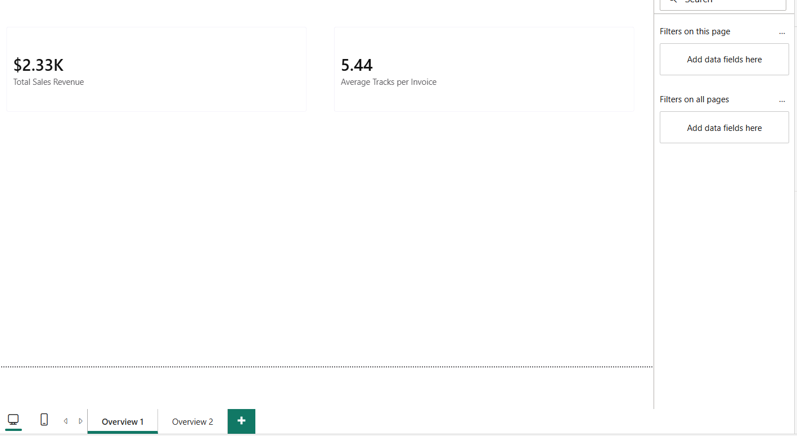
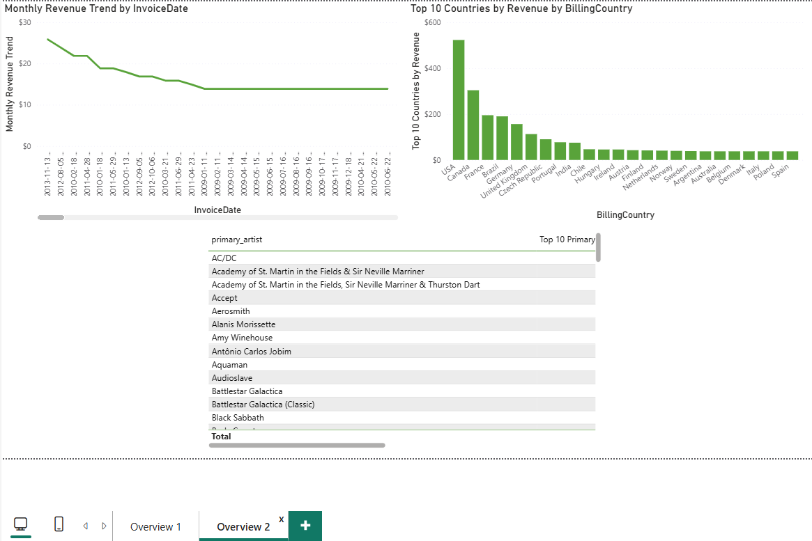
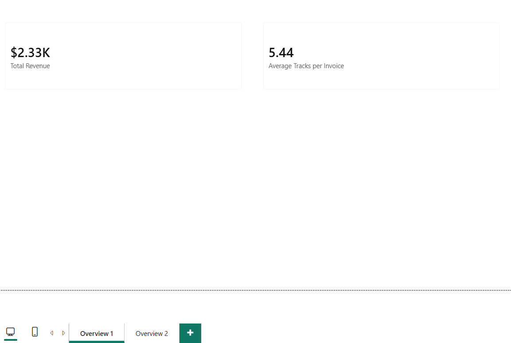
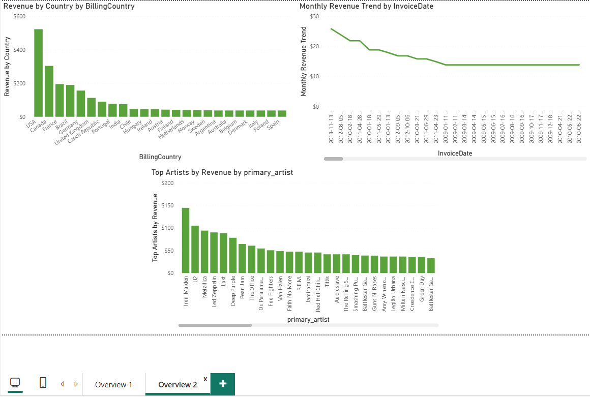

</details>

<details>
<summary>Online Retail — 2 pages × 2 providers</summary>

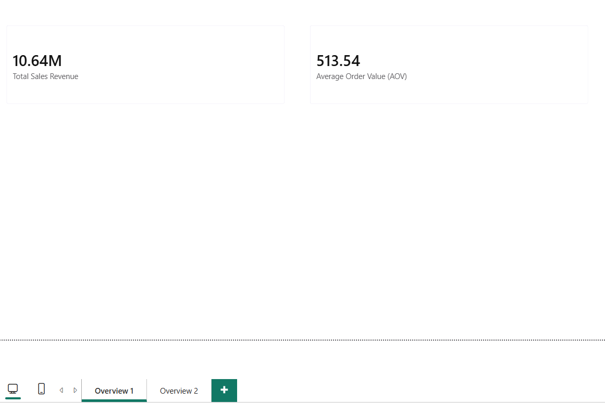
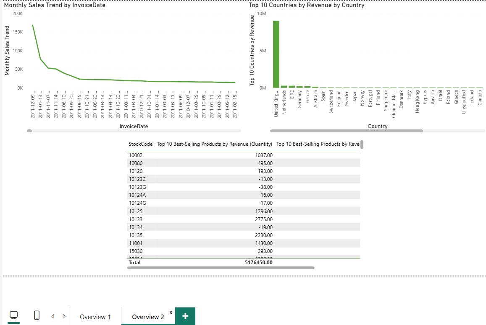
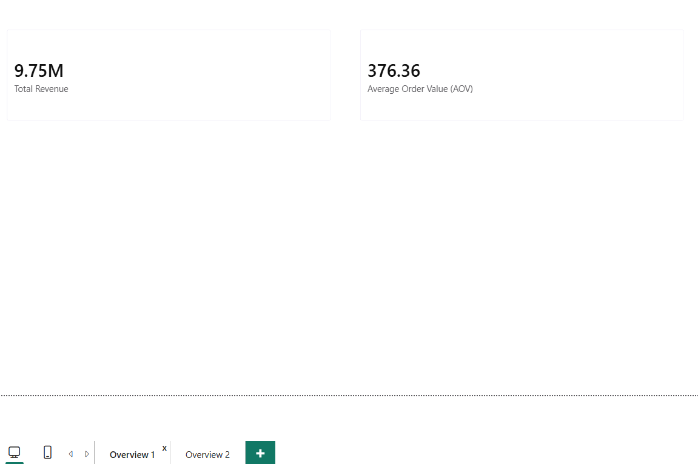
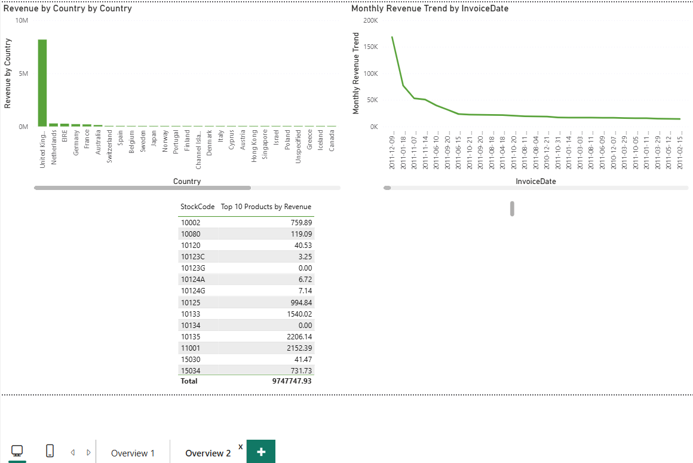

</details>

<details>
<summary>HR Analytics — 3 pages × 2 providers</summary>

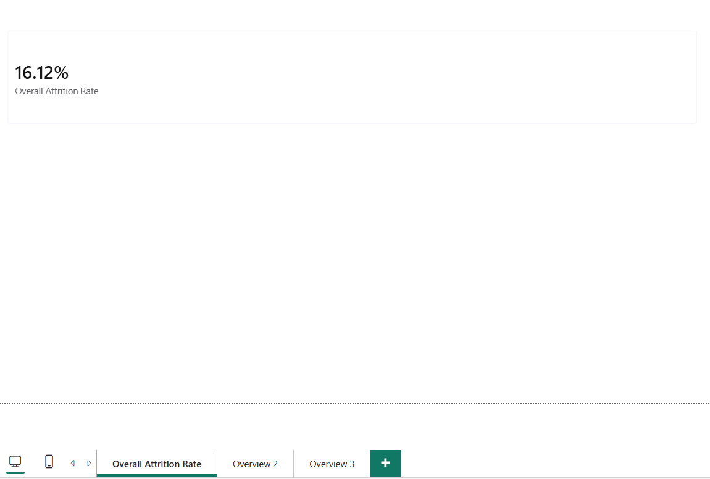
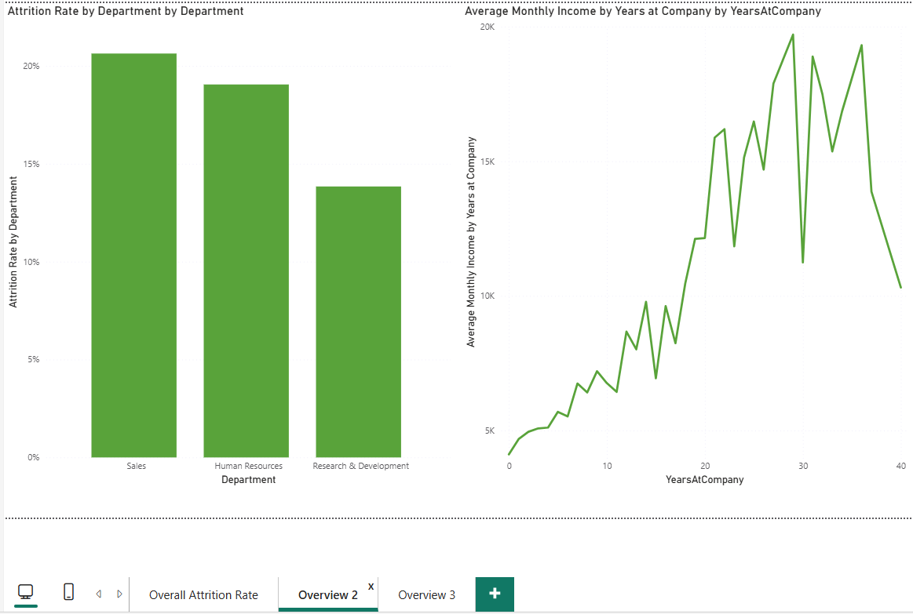
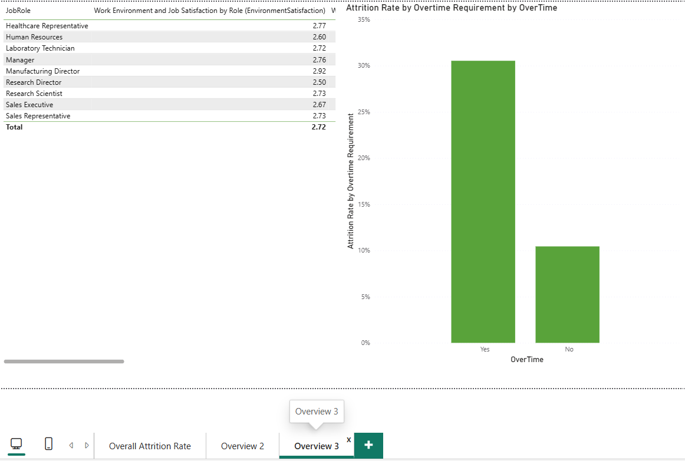
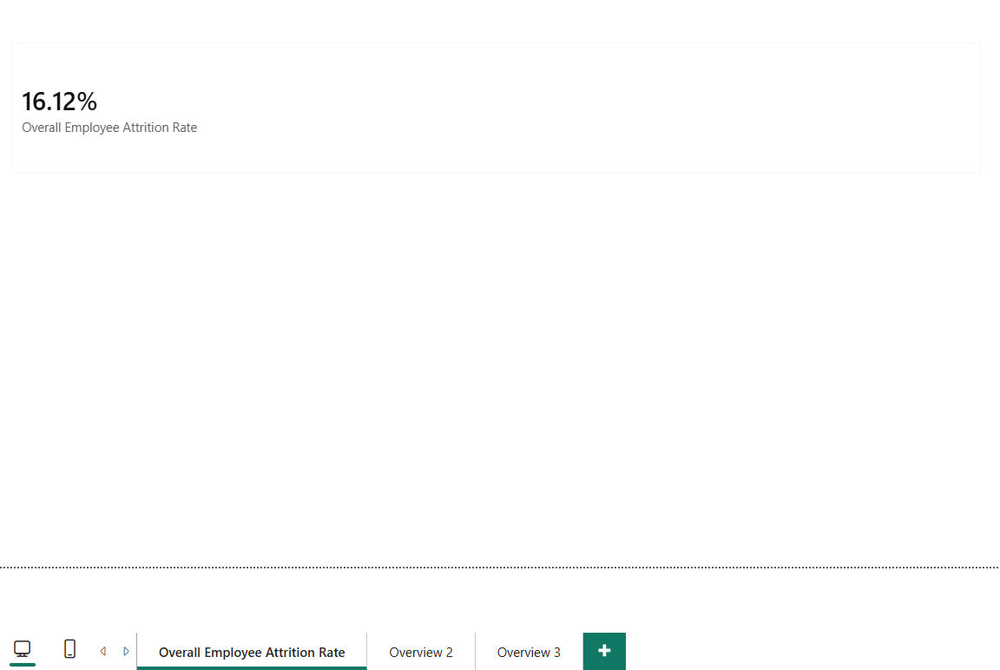
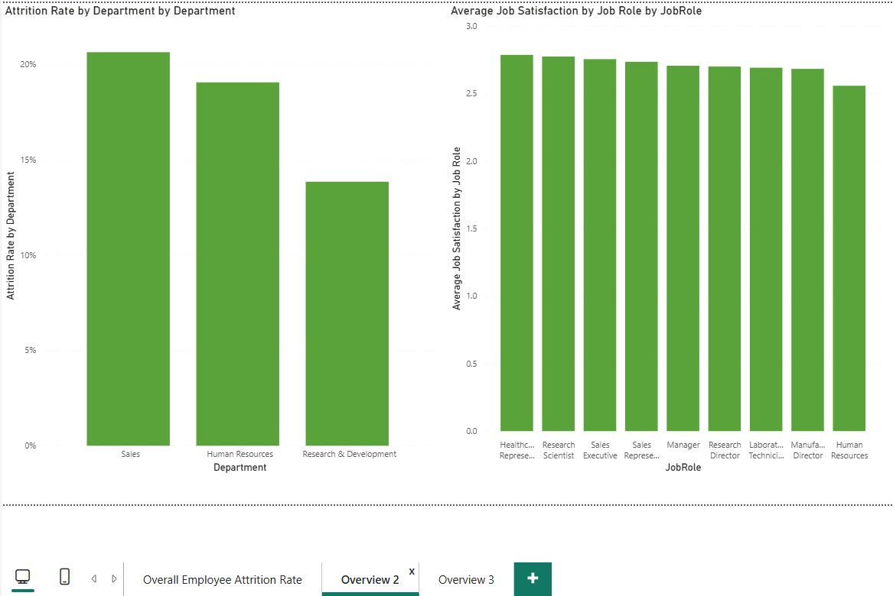
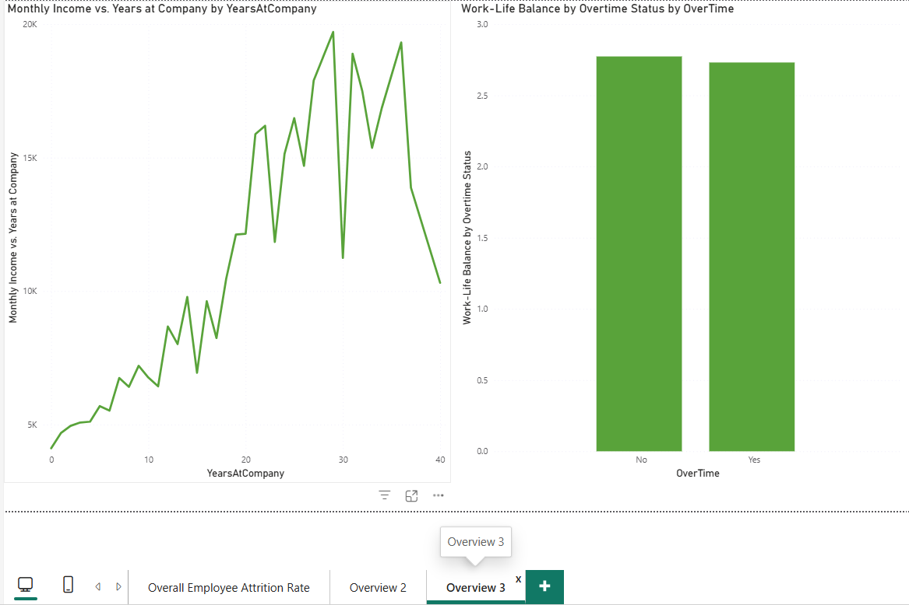

</details>

### Gemini vs. Mistral: Provider Comparison

| Metric | Mistral | Gemini |
|---|---|---|
| Total time, all 3 datasets | 49.36s | 78.90s |
| Average `domain_kpi` time | 11.17s | 12.34s |
| Average `reflector` time | 2.78s | 9.06s |
| KPI naming style | Consistently short (`Total Revenue`, `Revenue by Country`) | Consistently longer/more descriptive (`Top 10 Best-Selling Products by Revenue`); the direct cause of the visual-name-length bug fixed below. Mistral's shorter style never triggered it |
| Transient provider errors this round | One 429 rate-limit on `domain_kpi` (HR), auto-recovered via fallback model | One 503 high-demand on `reflector` (Online Retail), auto-recovered via retry-with-backoff |
| KPIs dropped at compile time | 0/15 | 0/15 |
| Output value agreement (Chinook) | Identical to Gemini on simple aggregates (Total Revenue, Average Tracks per Invoice), verified visually, re-run confirmed | Identical to Mistral on the same two metrics. Labels differ (`Total Sales Revenue` vs. `Total Revenue`), values and layout do not |

Mistral is consistently faster across every node in every run this round. The gap is largest in `reflector` (Gemini averages ~3.3x Mistral's time there), plausibly related to Gemini's longer, more elaborated KPI names and reasoning text increasing prompt/response size. This isn't confirmed, just the most visible correlate in this data.

### Per-Node Timing

| Dataset | Provider | profiler | domain_kpi | sql_executor | reflector | sql_executor_retry | pbir_compiler | Total |
|---|---|---|---|---|---|---|---|---|
| Chinook | Mistral | 0.03s | 10.91s | 0.02s | 1.59s | N/A | 0.00s | 12.55s |
| Chinook | Gemini | 0.03s | 13.06s | 0.01s | 14.08s | N/A | 0.00s | 27.19s |
| Online Retail | Mistral | 0.88s | 10.64s | 2.55s | 1.97s | N/A | 0.00s | 16.03s |
| Online Retail | Gemini | 0.84s | 11.98s | 2.52s | 16.67s | N/A | 0.00s | 32.02s |
| HR Analytics | Mistral | 0.02s | 11.97s | 0.03s | 8.75s | N/A | 0.01s | 20.78s |
| HR Analytics | Gemini | 0.03s | 12.91s | 0.01s | 6.74s | N/A | 0.00s | 19.69s |

`sql_executor_retry` did not fire in this confirmation round for either provider, since no KPI needed a fix on first pass. (An earlier Gemini/Online Retail run did trigger it once, for a timestamp-granularity fix; see below for repeatable, on-demand evidence of the same retry path.)

### Reflector Correction: Fault-Injection Stress Test

`scripts/run_reflector_stress_test.py` deliberately injects three realistic SQL errors (`sql_error`, `wrong_aggregation`, `null_heavy`) into a copy of each dataset's real, already-validated KPI set, then runs the real SQL Executor and Reflector against the sabotaged copy. This is a separate, clearly-labelled test path: its output (`*_kpis_sabotaged.json`, `*_stress_test_reflection.json`) is never read by `run_agent.py` or any part of the real pipeline.

**Chinook (Gemini), 3/3 caught, 3/3 fixed:**
| KPI | Planted | Detected As | Fix Offered |
|---|---|---|---|
| Total Sales Revenue | sql_error | sql_error (exact) | Yes |
| Monthly Revenue Trend | wrong_aggregation | wrong_aggregation (exact) | Yes |
| Top 10 Countries by Revenue | null_heavy | wrong_aggregation | Yes |

**Online Retail (Gemini), 3/3 caught, 3/3 fixed:**
| KPI | Planted | Detected As | Fix Offered |
|---|---|---|---|
| Total Sales Revenue | sql_error | sql_error (exact) | Yes |
| Monthly Sales Trend | wrong_aggregation | wrong_aggregation (exact) | Yes |
| Top 10 Countries by Revenue | null_heavy | wrong_aggregation | Yes |

**Chinook (Mistral), 3/3 caught, 3/3 fixed:**
| KPI | Planted | Detected As | Fix Offered |
|---|---|---|---|
| Total Revenue | sql_error | implausible_result | Yes |
| Revenue by Country | wrong_aggregation | wrong_aggregation (exact) | Yes |
| Monthly Revenue Trend | null_heavy | wrong_aggregation | Yes |

**Online Retail (Mistral), 3/3 caught, 3/3 fixed:**
| KPI | Planted | Detected As | Fix Offered |
|---|---|---|---|
| Total Revenue | sql_error | sql_error (exact) | Yes |
| Revenue by Country | wrong_aggregation | wrong_aggregation (exact) | Yes |
| Monthly Revenue Trend | null_heavy | wrong_aggregation | Yes |

12/12 planted issues caught this round (2 datasets × 3 fault types per provider, run under both providers), 12/12 had a fix offered, 0 missed. This is consistent with an earlier stress-test round run before the `builder.py`/`serialiser.py` fixes below (also 12/12), for 24/24 total across the two stress-test rounds to date (HR was not included in the stress harness). In every run, the `null_heavy` injection was categorised as `wrong_aggregation` rather than an exact match (6/24 adjacent-category diagnoses across both rounds), a defensible alternate diagnosis, since the injected query's root problem (grouping by the wrong column) manifests as an aggregation error before it manifests as null-heaviness; the Reflector consistently identified the actual defect.

On the natural (non-sabotaged) confirmation runs reported above, the Reflector flagged issues in 0–1 KPI per dataset (one organic catch on Online Retail/Gemini for a timestamp-granularity issue). The Reflector's correction capability is demonstrated primarily by planted-fault evidence, not by a high organic error rate — because when the upstream SQL is well-formed, there is typically nothing for it to fix.

Committed artifacts for one full stress-test round (profiles, KPI specs, sabotaged copies, stress reflections, regenerated query results and run summaries) live under [`evidence/v1/`](evidence/v1/) — see its README for provenance and regeneration commands.

### Failure Modes Observed (and Fixed)

Three real bugs were found via this validation pass and fixed before the confirmation round above. All three are `pbir/compiler/` issues (SQL→DAX translation and `.pbip` serialisation), not `agent/` pipeline logic:

| Failure | Dataset / Provider | Description | Resolution |
|---|---|---|---|
| SQL→DAX translation gap: `CAST`/`COUNT(CASE WHEN...)` conditional-percentage phrasing | HR Analytics, both providers | 3 of 5 KPIs failed translation with `Cannot translate SQL to basic DAX`, dropping HR below the 4-visual minimum and blocking the build entirely | Fixed: `builder.py`'s translator extended to recognise this phrasing alongside the originally-supported `SUM(CASE WHEN...ELSE...)` form |
| Relative Power Query source path | All three datasets, both providers | `.pbip` failed to load in Power BI Desktop: "the supplied file path must be a valid absolute path" | Fixed: `serialiser.py`'s M-query builder resolves a relative path to absolute; an already-absolute path (POSIX or Windows) is left untouched |
| Visual name exceeding Desktop's 50-character limit | Chinook and HR, Gemini only | Gemini's more descriptive KPI naming style produced `visual_id`s over 50 characters, which Desktop rejects outright at load time. Never triggered by Mistral's shorter naming style | Fixed: `serialiser.py` truncates `visual_id` to 50 chars consistently across the visual's folder name, its own `visual.json` name, and its filter names |

**Previously known gap, now fixed:** `COUNT(DISTINCT col) ... WHERE col IS NOT NULL` used to fail SQL→DAX translation (observed once, Online Retail/Gemini, an earlier run's `Total Unique Customers` KPI — the report still built above the 4-visual minimum in that instance). Closed during flagship hardening: the translator now recognises `IS [NOT] NULL` filter conditions (mapped to DAX blank comparisons inside `CALCULATE`) and T-SQL-style bracket-quoted identifiers (`[Total]`), with regression tests in `tests/test_pbir_compiler.py`. Any shape outside the supported set still fails closed.

**No instances observed:** wrong domain inference, in any run, either provider.

---

## Known Limitations and Stretch Goals

**DAX coverage is the largest limitation.** SQL→DAX translation is intentionally regex-based rather than a real SQL parser, and covers only basic measure expressions (`SUM`, `AVERAGE`, `COUNT`, `DIVIDE`, `IF`, the `CASE WHEN` conditional-percentage form added during Phase 4, single-condition `WHERE` filters including `IS [NOT] NULL`, and bracket-quoted identifiers — the last two closed during flagship hardening). More complex DAX patterns (time intelligence, `CALCULATE` with multiple filters, and anything outside the supported patterns) are out of scope, so KPIs the LLM proposes in SQL that fall outside this pattern set either fail translation (caught and surfaced, as with the HR `CAST`/`COUNT(CASE WHEN...)` bug) or are dropped.

**Visuals are basic by design.** The compiler supports four chart types only (card, bar chart, line chart, table), matched to whichever of these best fits each KPI's SQL intent. There is no support for combo charts, custom visuals, drill-through, or conditional formatting beyond the static per-visual-type templates established during PBIR reverse-engineering.

**Expected behavior, not a bug: "some tables have incomplete or no data" on first open.** Every freshly-compiled or freshly-cloned `.pbip` project shows this banner the first time it's opened in Desktop, simply because `.pbi/cache.abf` doesn't exist yet (correctly, since the compiler should never write it). The fix is clicking **Refresh** once the report opens; the banner won't reappear once Desktop has cached a successful load. This is a genuinely separate situation from the M-escaping partition-load failure documented in `docs/pbir_reference.md` (§2.12), which produces the *same visible banner text*, and is exactly what makes it easy to wrongly write off a real bug as "oh, that's just the first-open thing." If the banner persists after clicking Refresh, rather than resolving on the first refresh, treat that as a real signal something in that table's partition is actually broken, not as more of the expected first-open behavior. See `docs/pbir_reference.md` for the full writeup.

This is unrelated to the "no Power BI Service scheduled refresh" limitation below: that one is about automated refresh on a publishing target that's out of scope for this project; the note above is a one-time manual click inside Desktop itself, on any freshly-generated report, regardless of publishing.

**Report path coupling.** The compiled Power Query M partition embeds the absolute path of the source CSV on the compiling machine (by Power BI's requirement — `File.Contents(...)` does not accept repo-relative paths). A `.pbip` compiled on one machine must be opened on that same machine, or the CSV must be moved to the same absolute path on another machine. When opening for the first time after moving, click **Refresh** once and the report will load — see the first-open banner note above. To compile for a different machine, re-run `run_agent.py` with `--input` pointing at that machine's CSV location.

Other known limitations:
- **Single-table input only.** No multi-table joins in this MVP; a 2-table join was scoped as a stretch goal and not implemented.
- **SQLite dialect only.** All generated SQL is validated against SQLite syntax; no other SQL dialect is supported.
- **Regex-based SQL validation**, not a formal grammar. Built incrementally against observed LLM output and hardened against several real false-positive patterns (string literals, qualified column references, table aliases), but not a general-purpose SQL linter.
- **Power BI Desktop only.** No Power BI Service publishing, scheduled refresh, or embedded deployment.
- **The agent itself is CLI-only.** It has no interactive frontend. `app.py` is a read-only demonstration of the deterministic half (committed KPI fixtures, no LLM calls), not a UI for running or steering the agent; a Streamlit debugging UI for live agent runs was scoped as a stretch goal and deliberately not implemented.
- **One retry per flagged KPI.** A KPI still failing after its single retry, or with no concrete fix offered, is dropped from the output rather than surfaced as a partial/failed visual.

Stretch goals not pursued in this MVP:
- Multi-table joins / relational schema support
- A debugging UI for live agent runs (Streamlit) — the deterministic demo in `app.py` is deliberately not this
- Broader DAX pattern coverage (the `COUNT(DISTINCT)` null-filter gap above is already closed; multi-condition filters, time intelligence, and wider shape support remain future work)
- Additional visual types and richer layout logic beyond the current 2–3-page groupings

---

## Repository Structure

See [`STRUCTURE.md`](STRUCTURE.md) for the full file tree.

```
agent/            Core LangGraph pipeline nodes
pbir/             PBIR compiler (models + compiler)
scripts/          Standalone driver and validation scripts
data/             Input datasets (generated profiles are gitignored)
evidence/         Committed, dated run artifacts behind the results below
tests/            264 tests (124 in test_pbir_compiler.py alone; 104 across agent/)
notebooks/        Exploration and validation notebooks
docs/             PBIR reference documentation (1,129 lines)
app.py            Deterministic Streamlit demo (no API keys)
demo_core.py      Headless core of that demo (unit-tested, no Streamlit import)
run_agent.py      CLI entry point
```

---

## Setup

Supported Python: **3.10, 3.11, 3.12** (see `requirements.txt`; CI matrix in
`.github/workflows/tests.yml`).

```bash
git clone https://github.com/Tessa-Saumu/Agentic-BI-Builder
cd Agentic-BI-Builder
pip install -r requirements.txt
cp .env.example .env       # add your GEMINI_API_KEY or MISTRAL_API_KEY
python run_agent.py --input data/raw/chinook.csv --output output/chinook_report
```

Then open `output/chinook_report/chinook.pbip` in Power BI Desktop (Windows).

**Fresh-clone note:** after `pip install -r requirements.txt`, a bare `pytest`
should report **261 passed, 3 skipped, 0 errors, 0 failures** with no additional
setup steps — no generated profiles to produce, no API keys, no network access
(every LLM call in the suite is mocked). The 3 skips are the Streamlit UI tests
in `tests/test_demo_app.py`, which need the demo-only dependency: install
`requirements-demo.txt` as well and all **264** tests run and pass.
`data/profiles/` is created by the pipeline when you run it and is gitignored.
To regenerate schema profiles for all three datasets without an API key, run
`python scripts/profile_datasets.py`.

---

*In development: June–August 2026 (`v1.0.0` released 2026-08-30). Flagship consolidation — evidence bundle, verification tests, translator gap closure, deterministic public demo: October 2026.*
