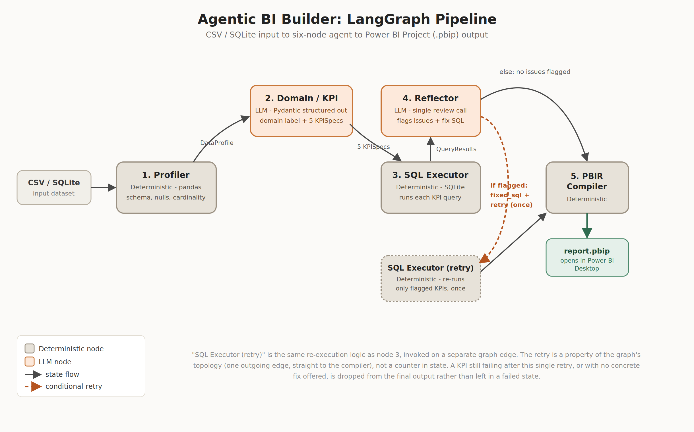
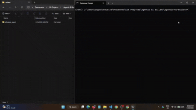

# Agentic BI Builder

> A LangGraph-powered analytics agent that profiles a structured dataset, proposes relevant KPIs, generates and validates SQL queries, reflects on its own outputs, and compiles a real Power BI Project (.pbip) folder, ready to open directly in Power BI Desktop.

---

## Problem Statement

Starting a BI project from a new dataset involves hours of repetitive scaffolding work: inspecting the schema, deciding which metrics matter, writing aggregation queries, and manually mapping results into a dashboard layout. This process is largely mechanical, yet it still requires enough domain inference (recognising that a dataset is a music retailer versus an HR system, for instance) that it can't be reduced to a fixed template or a set of simple rules.

This project explores whether a LangGraph-based agentic system can automate that entire setup phase end to end: taking a raw CSV as input and producing a working Power BI report as output, without a human deciding which metrics matter or hand-writing a single query. The agent profiles the data deterministically, infers a business domain and proposes KPIs with an LLM, executes and validates the resulting SQL against real data, reflects on its own output to catch and fix mistakes, and compiles the validated results into a genuine `.pbip` project that opens natively in Power BI Desktop.

---

## Architecture



```
CSV input
    │
    ▼
┌─────────────────────────────────────────────────────────┐
│                    LANGGRAPH AGENT                      │
│                                                         │
│  Profiler ──▶ Domain/KPI Node ──▶ SQL Executor          │
│  (Pandas)      (LLM + Pydantic)    (SQLite)             │
│                                         │               │
│                                         ▼               │
│  PBIR Compiler ◀── Reflector ◀── Validation check       │
│  (Python)          (LLM)                                │
└─────────────────────────────────────────────────────────┘
    │
    ▼
.pbip folder → open in Power BI Desktop
```

## Demo



*Terminal run of `run_agent.py` against the Chinook dataset: profiling, then KPI generation, SQL execution, reflection, and compile, followed by opening the resulting `.pbip` in Power BI Desktop.*

---

## Quickstart

```bash
git clone https://github.com/your-username/agentic-bi-builder
cd agentic-bi-builder

python -m venv .venv
source .venv/bin/activate        # .venv\Scripts\activate on Windows

pip install -r requirements.txt

cp .env.example .env             # add GEMINI_API_KEY and/or MISTRAL_API_KEY
                                  # set LLM_PROVIDER=gemini or mistral

python run_agent.py --input data/raw/chinook.csv --output output/chinook_report
```

Then open `output/chinook_report/report.pbip` in Power BI Desktop.

The other two reference datasets run the same way:

```bash
python run_agent.py --input data/raw/online_retail.csv --output output/online_retail_report
python run_agent.py --input data/raw/hr_analytics.csv --output output/hr_report
```

---

## Agent Nodes

| Node | Type | What it does |
|---|---|---|
| Profiler | Deterministic | Pandas-based schema analysis: column types, null rates, distinct counts, sample values |
| Domain/KPI | LLM | Infers business domain (retail, HR, finance, etc.) and proposes 5 KPIs with SQL, chart type, and reasoning |
| SQL Executor | Deterministic | Loads the CSV into SQLite, runs each KPI query, captures results and errors |
| Reflector | LLM | Reviews profile + KPI list + results in a single call, flags mismatches (wrong aggregations, null-heavy columns, implausible values, SQL errors), and returns corrected SQL for each flagged KPI |
| SQL Executor (retry) | Deterministic | Re-runs only the KPIs the Reflector flagged, using the fix it supplied, exactly once per KPI, then drops any KPI still failing |
| PBIR Compiler | Deterministic | Maps validated query results to Pydantic PBIR models and writes the `.pbip` folder structure |

The retry is a property of the graph's topology rather than a counter in state: the retry-executor node has exactly one outgoing edge, straight to the PBIR Compiler, so a second reflection pass can never fire for the same KPI.

---

## PBIR Output Structure

The agent emits a valid Power BI Project: two independent "documents," `<name>.Report/` and `<name>.SemanticModel/`, linked only by a relative path in `<name>.Report/definition.pbir`. Power BI Desktop opens the root `.pbip` file directly.

```
<name>.pbip                          # root pointer file
<name>.Report/
├── definition.pbir                  # points Report -> SemanticModel
└── definition/
    ├── report.json                  # theme + report-level settings
    ├── version.json                 # schema version pin
    └── pages/
        ├── pages.json               # page order + active page
        └── <pageId>/
            ├── page.json            # one per page
            └── visuals/
                └── <visualId>/
                    └── visual.json  # one per visual (field bindings, chart type)

<name>.SemanticModel/
└── definition/
    ├── database.tmdl                # fixed, 2 lines
    ├── model.tmdl                   # table references
    └── tables/
        └── <table>.tmdl             # schema + M query + DAX measures, the core dynamic file
```

(`.platform` metadata files, theme resources, and Desktop-owned cache files also exist on disk but are omitted above since the compiler either copies them verbatim as fixed templates or never writes them at all.)

Each `<table>.tmdl` is where a KPI actually becomes a Power BI artifact: one `measure` block per KPI holding its DAX expression, one `column` block per source column, and a `partition` block whose `source` is the Power Query M script that loads the CSV at Desktop open or refresh time. There is no separate "data model" JSON file or "connections" file; the model schema, the DAX measures, and the data-source connection are all part of this one TMDL file per table. This structure is reverse-engineered from a real `.pbip` export (see `docs/pbir_reference.md`) and modelled as Pydantic classes for the JSON files plus a dedicated TMDL writer for the SemanticModel side, so the agent populates typed Python objects rather than hand-building either format as raw strings.

---

## Tech Stack

| Layer | Tools |
|---|---|
| Agent orchestration | LangGraph |
| LLM | Google Gemini (`gemini-3.1-flash` / `gemini-3.1-pro`) or Mistral AI (`open-mixtral-8x7b` / `mistral-large`) |
| Data profiling | pandas |
| SQL execution | SQLite (`sqlite3`) |
| Structured outputs | Pydantic, provider-native structured output (no LangChain) |
| PBIR generation | Python (custom PBIR compiler), TMDL |
| Visualisation | Power BI Desktop |
| Version control | Git, GitHub |

`LLM_PROVIDER` switches between `gemini` and `mistral` at runtime via `.env`. Both are used in place of the originally-scoped Anthropic/OpenAI providers to stay on free tiers, confirmed with the mentor before implementation.

---

## Test Datasets

| Dataset | Domain | Source |
|---|---|---|
| Chinook | Music retail | Public SQLite sample DB |
| Online Retail | E-commerce | UCI ML Repository |
| HR Analytics | Human resources | Kaggle public dataset |

---

## Per-Dataset Results

All three datasets run end-to-end via `run_agent.py` without crashing, under both supported LLM providers, on every KPI (5/5, no drops).

| Dataset | Domain Inferred | KPIs Generated | Reflection Fixes | Report Screenshot |
|---|---|---|---|---|
| Chinook | Digital music retail (e-commerce) | 5/5 | None needed on this confirmation run. Reflector correction demonstrated separately via fault-injection stress test (below) | [`gemini_page2_country_trend_artists.png`](assets/chinook/gemini_page2_country_trend_artists.png) |
| Online Retail | E-commerce retail | 5/5 | One organic catch-and-fix during earlier validation (Gemini): a timestamp-granularity issue | [`gemini_page2_country_trend_products.png`](assets/online_retail/gemini_page2_country_trend_products.png) |
| HR Analytics | HR / employee retention and satisfaction | 5/5 | None needed on this confirmation run | [`gemini_page2_department_and_income.png`](assets/hr_analytics/gemini_page2_department_and_income.png) |

The full breakdown below (per-provider KPI lists, timing, and the fault-injection stress test that gives repeatable evidence of the Reflector's correction capability) expands on this summary.

### Chinook

| Provider | Domain Inferred | KPIs Proposed | Reflection | Pages / Visuals | Total Time |
|---|---|---|---|---|---|
| Mistral | digital music retail (e-commerce) | Total Revenue, Revenue by Country, Monthly Revenue Trend, Average Tracks per Invoice, Top Artists by Revenue | No issues found | 2 / 5 | 12.55s |
| Gemini | digital music store retail | Total Sales Revenue, Monthly Revenue Trend, Top 10 Countries by Revenue, Top 10 Primary Artists by Revenue, Average Tracks per Invoice | No issues found | 2 / 5 | 27.19s |

**Verified:** Page 1 (cards) renders visually identical between providers, with the same `$2.33K` Total Revenue and `5.44` Average Tracks per Invoice values, confirmed by re-running Chinook on both providers and comparing side by side. Chinook's small, fixed dataset and simple aggregations (`SUM`, `AVG`) have only one correct value regardless of how each LLM names or phrases the KPI, so the underlying numbers match even though the KPI labels differ (`Total Sales Revenue` vs. `Total Revenue`). See [`gemini_page1_revenue_tracks.png`](assets/chinook/gemini_page1_revenue_tracks.png) and [`mistral_page1_revenue_tracks.png`](assets/chinook/mistral_page1_revenue_tracks.png).

### Online Retail

| Provider | Domain Inferred | KPIs Proposed | Reflection | Pages / Visuals | Total Time |
|---|---|---|---|---|---|
| Mistral | e-commerce retail | Total Revenue, Revenue by Country, Monthly Revenue Trend, Average Order Value (AOV), Top 10 Products by Revenue | No issues found | 2 / 5 | 16.03s |
| Gemini | e-commerce retail | Total Sales Revenue, Monthly Sales Trend, Top 10 Countries by Revenue, Top 10 Best-Selling Products by Revenue, Average Order Value (AOV) | No issues found | 2 / 5 | 32.02s |

### HR Analytics

| Provider | Domain Inferred | KPIs Proposed | Reflection | Pages / Visuals | Total Time |
|---|---|---|---|---|---|
| Mistral | HR/employee retention and satisfaction | Attrition Rate by Department, Average Job Satisfaction by Job Role, Monthly Income vs. Years at Company, Work-Life Balance by Overtime Status, Overall Employee Attrition Rate | No issues found | 3 / 5 | 20.78s |
| Gemini | HR / Talent Analytics | Overall Attrition Rate, Attrition Rate by Department, Average Monthly Income by Years at Company, Work Environment and Job Satisfaction by Role, Attrition Rate by Overtime Requirement | No issues found | 3 / 5 | 19.69s |

### Gemini vs. Mistral: Provider Comparison

| Metric | Mistral | Gemini |
|---|---|---|
| Total time, all 3 datasets | 49.36s | 78.90s |
| Average `domain_kpi` time | 11.17s | 12.34s |
| Average `reflector` time | 2.78s | 9.06s |
| KPI naming style | Consistently short (`Total Revenue`, `Revenue by Country`) | Consistently longer/more descriptive (`Top 10 Best-Selling Products by Revenue`); the direct cause of the visual-name-length bug fixed below. Mistral's shorter style never triggered it |
| Transient provider errors this round | One 429 rate-limit on `domain_kpi` (HR), auto-recovered via fallback model | One 503 high-demand on `reflector` (Online Retail), auto-recovered via retry-with-backoff |
| KPIs dropped at compile time | 0/15 | 0/15 |
| Output value agreement (Chinook) | Identical to Gemini on simple aggregates (Total Revenue, Average Tracks per Invoice), verified visually, re-run confirmed | Identical to Mistral on the same two metrics. Labels differ (`Total Sales Revenue` vs. `Total Revenue`), values and layout do not |

Mistral is consistently faster across every node in every run this round. The gap is largest in `reflector` (Gemini averages ~3.3x Mistral's time there), plausibly related to Gemini's longer, more elaborated KPI names and reasoning text increasing prompt/response size. This isn't confirmed, just the most visible correlate in this data.

### Per-Node Timing

| Dataset | Provider | profiler | domain_kpi | sql_executor | reflector | sql_executor_retry | pbir_compiler | Total |
|---|---|---|---|---|---|---|---|---|
| Chinook | Mistral | 0.03s | 10.91s | 0.02s | 1.59s | N/A | 0.00s | 12.55s |
| Chinook | Gemini | 0.03s | 13.06s | 0.01s | 14.08s | N/A | 0.00s | 27.19s |
| Online Retail | Mistral | 0.88s | 10.64s | 2.55s | 1.97s | N/A | 0.00s | 16.03s |
| Online Retail | Gemini | 0.84s | 11.98s | 2.52s | 16.67s | N/A | 0.00s | 32.02s |
| HR Analytics | Mistral | 0.02s | 11.97s | 0.03s | 8.75s | N/A | 0.01s | 20.78s |
| HR Analytics | Gemini | 0.03s | 12.91s | 0.01s | 6.74s | N/A | 0.00s | 19.69s |

`sql_executor_retry` did not fire in this confirmation round for either provider, since no KPI needed a fix on first pass. (An earlier Gemini/Online Retail run did trigger it once, for a timestamp-granularity fix; see below for repeatable, on-demand evidence of the same retry path.)

### Reflector Correction: Fault-Injection Stress Test

`scripts/run_reflector_stress_test.py` deliberately injects three realistic SQL errors (`sql_error`, `wrong_aggregation`, `null_heavy`) into a copy of each dataset's real, already-validated KPI set, then runs the real SQL Executor and Reflector against the sabotaged copy. This is a separate, clearly-labelled test path: its output (`*_kpis_sabotaged.json`, `*_stress_test_reflection.json`) is never read by `run_agent.py` or any part of the real pipeline.

**Chinook (Gemini), 3/3 caught, 3/3 fixed:**
| KPI | Planted | Detected As | Fix Offered |
|---|---|---|---|
| Total Sales Revenue | sql_error | sql_error (exact) | Yes |
| Monthly Revenue Trend | wrong_aggregation | wrong_aggregation (exact) | Yes |
| Top 10 Countries by Revenue | null_heavy | wrong_aggregation | Yes |

**Online Retail (Gemini), 3/3 caught, 3/3 fixed:**
| KPI | Planted | Detected As | Fix Offered |
|---|---|---|---|
| Total Sales Revenue | sql_error | sql_error (exact) | Yes |
| Monthly Sales Trend | wrong_aggregation | wrong_aggregation (exact) | Yes |
| Top 10 Countries by Revenue | null_heavy | wrong_aggregation | Yes |

**Chinook (Mistral), 3/3 caught, 3/3 fixed:**
| KPI | Planted | Detected As | Fix Offered |
|---|---|---|---|
| Total Revenue | sql_error | implausible_result | Yes |
| Revenue by Country | wrong_aggregation | wrong_aggregation (exact) | Yes |
| Monthly Revenue Trend | null_heavy | wrong_aggregation | Yes |

**Online Retail (Mistral), 3/3 caught, 3/3 fixed:**
| KPI | Planted | Detected As | Fix Offered |
|---|---|---|---|
| Total Revenue | sql_error | sql_error (exact) | Yes |
| Revenue by Country | wrong_aggregation | wrong_aggregation (exact) | Yes |
| Monthly Revenue Trend | null_heavy | wrong_aggregation | Yes |

12/12 planted issues caught this round, 12/12 had a fix offered, 0 missed. This is consistent with an earlier stress-test round run before the `builder.py`/`serialiser.py` fixes below (also 12/12), for 24/24 total across every stress test run to date. In every run, the `null_heavy` injection was categorised as `wrong_aggregation` rather than an exact match, a defensible alternate diagnosis, since the injected query's root problem (grouping by the wrong column) manifests as an aggregation error before it manifests as null-heaviness; the Reflector consistently identified the actual defect.

### Failure Modes Observed (and Fixed)

Three real bugs were found via this validation pass and fixed before the confirmation round above. All three are `pbir/compiler/` issues (SQL→DAX translation and `.pbip` serialisation), not `agent/` pipeline logic:

| Failure | Dataset / Provider | Description | Resolution |
|---|---|---|---|
| SQL→DAX translation gap: `CAST`/`COUNT(CASE WHEN...)` conditional-percentage phrasing | HR Analytics, both providers | 3 of 5 KPIs failed translation with `Cannot translate SQL to basic DAX`, dropping HR below the 4-visual minimum and blocking the build entirely | Fixed: `builder.py`'s translator extended to recognise this phrasing alongside the originally-supported `SUM(CASE WHEN...ELSE...)` form |
| Relative Power Query source path | All three datasets, both providers | `.pbip` failed to load in Power BI Desktop: "the supplied file path must be a valid absolute path" | Fixed: `serialiser.py`'s M-query builder resolves a relative path to absolute; an already-absolute path (POSIX or Windows) is left untouched |
| Visual name exceeding Desktop's 50-character limit | Chinook and HR, Gemini only | Gemini's more descriptive KPI naming style produced `visual_id`s over 50 characters, which Desktop rejects outright at load time. Never triggered by Mistral's shorter naming style | Fixed: `serialiser.py` truncates `visual_id` to 50 chars consistently across the visual's folder name, its own `visual.json` name, and its filter names |

**Known remaining gap, not fixed:** `COUNT(DISTINCT col) ... WHERE col IS NOT NULL` still fails SQL→DAX translation (observed once, Online Retail/Gemini, an earlier run's `Total Unique Customers` KPI). The report still built above the 4-visual minimum in that instance. Documented under Known Limitations below for a future `builder.py` fix.

**No instances observed:** wrong domain inference, in any run, either provider.

---

## Known Limitations and Stretch Goals

**DAX coverage is the largest limitation.** SQL→DAX translation is intentionally regex-based rather than a real SQL parser, and covers only basic measure expressions (`SUM`, `AVERAGE`, `COUNT`, `DIVIDE`, `IF`, and the `CASE WHEN` conditional-percentage form added during Phase 4). `COUNT(DISTINCT col) ... WHERE col IS NOT NULL` is a known, unfixed gap. More complex DAX patterns (time intelligence, `CALCULATE` with multiple filters, and anything outside the supported patterns) are out of scope, so KPIs the LLM proposes in SQL that fall outside this pattern set either fail translation (caught and surfaced, as with the HR `CAST`/`COUNT(CASE WHEN...)` bug) or are dropped.

**Visuals are basic by design.** The compiler supports four chart types only (card, bar chart, line chart, table), matched to whichever of these best fits each KPI's SQL intent. There is no support for combo charts, custom visuals, drill-through, or conditional formatting beyond the static per-visual-type templates established during PBIR reverse-engineering.

**Expected behavior, not a bug: "some tables have incomplete or no data" on first open.** Every freshly-compiled or freshly-cloned `.pbip` project shows this banner the first time it's opened in Desktop, simply because `.pbi/cache.abf` doesn't exist yet (correctly, since the compiler should never write it). The fix is clicking **Refresh** once the report opens; the banner won't reappear once Desktop has cached a successful load. This is a genuinely separate situation from the M-escaping partition-load failure documented in `docs/pbir_reference.md` (§2.12), which produces the *same visible banner text*, and is exactly what makes it easy to wrongly write off a real bug as "oh, that's just the first-open thing." If the banner persists after clicking Refresh, rather than resolving on the first refresh, treat that as a real signal something in that table's partition is actually broken, not as more of the expected first-open behavior. See `docs/pbir_reference.md` for the full writeup.

This is unrelated to the "no Power BI Service scheduled refresh" limitation below: that one is about automated refresh on a publishing target that's out of scope for this project; the note above is a one-time manual click inside Desktop itself, on any freshly-generated report, regardless of publishing.

Other known limitations:
- **Single-table input only.** No multi-table joins in this MVP; a 2-table join was scoped as a stretch goal and not implemented.
- **SQLite dialect only.** All generated SQL is validated against SQLite syntax; no other SQL dialect is supported.
- **Regex-based SQL validation**, not a formal grammar. Built incrementally against observed LLM output and hardened against several real false-positive patterns (string literals, qualified column references, table aliases), but not a general-purpose SQL linter.
- **Power BI Desktop only.** No Power BI Service publishing, scheduled refresh, or embedded deployment.
- **CLI only.** No user interface; a Streamlit debugging UI was scoped as a stretch goal and not implemented.
- **One retry per flagged KPI.** A KPI still failing after its single retry, or with no concrete fix offered, is dropped from the output rather than surfaced as a partial/failed visual.

Stretch goals not pursued in this MVP:
- Multi-table joins / relational schema support
- A debugging UI (Streamlit)
- Broader DAX pattern coverage, closing the `COUNT(DISTINCT)` gap above
- Additional visual types and richer layout logic beyond the current 2–3-page groupings

---

## Repository Structure

See [`STRUCTURE.md`](STRUCTURE.md) for the full file tree.

```
agent/            Core LangGraph pipeline nodes
pbir/             PBIR compiler (models + compiler)
scripts/          Standalone driver and validation scripts
data/             Input datasets and generated profiling/KPI artifacts
tests/            Unit tests (119 passing in test_pbir_compiler.py alone; 70+ across agent/)
notebooks/         Exploration and validation notebooks
docs/             PBIR reference documentation
run_agent.py      CLI entry point
```

---

## Setup

```bash
git clone https://github.com/your-username/agentic-bi-builder
cd agentic-bi-builder
pip install -r requirements.txt
cp .env.example .env       # add your GEMINI_API_KEY or MISTRAL_API_KEY
python run_agent.py --input data/raw/chinook.csv --output output/chinook_report
```

Then open `output/chinook_report/report.pbip` in Power BI Desktop.

---

*In development: June/July 2026*