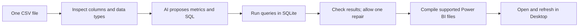

# Agentic BI Builder

I built a local workflow that turns a single data file into checked database queries and a Power BI project. An AI model proposes the business metrics; Python code executes the queries, checks the output and builds the report files.

This is a portfolio prototype developed under mentorship. It demonstrates how I connect uncertain AI output to predictable software checks. It is not a production analytics service, and I have not established general AI accuracy or measured business time savings.

## Try the public example

[Explore the anonymous evidence walkthrough](https://tessa-agentic-bi-evidence.purple-tick-2127.chatgpt.site).

The page shares 12 fictional invoices, five executed queries, their results and a downloadable two-page Power BI project. It is a prebuilt, deterministic illustration: the queries are hand-written and no live AI call happens in the browser. Deterministic means the same fixed input and instructions produce the same calculations. The example independently checks 258 total revenue in unspecified example units and 3.0 average tracks per invoice.

The source repository remains private. The public page makes the example data and output inspectable without granting source access or requiring a login. Its Power BI export was structurally checked, not freshly opened in Desktop during publication.

## The problem

Starting a business-intelligence report means inspecting a dataset, choosing useful measures, writing calculations and building the report structure. I wanted to explore which parts an AI-assisted workflow could handle while keeping its suggestions checkable.

## What I built

I implemented the workflow, its typed data contracts, query execution, report compiler and tests. A typed contract defines the fields and values each step must provide. The compiler converts supported query patterns into Power BI's report and data-model files. Unsupported calculations are rejected rather than guessed.

Mentor review and hardening contributions are retained in Git history. This is mentored individual implementation, not evidence that I wrote every supporting line without help.



CSV is a table stored as a text file. SQL is Structured Query Language, used to query the temporary SQLite database. LangGraph connects the workflow steps and limits the repair path to one retry; Pydantic checks the structured responses at step boundaries.

## What the checks establish

The last full verified suite passed 264 tests with demo dependencies installed. A focused follow-up passed 30 demo and end-to-end tests after the public-evidence/provenance edits. These checks cover real query execution, rejected/accepted builds, report structure, workflow routing and command exit behavior. Provider calls in tests are mocked: controlled substitute responses exercise the software mechanics, not the model's quality.

The new fictional example passed through the same profiler, SQLite executor and report compiler. Its five queries compiled to two pages and five visuals. A downloadable receipt records results and file fingerprints.

Historical AI-run artifacts are in [the evidence bundle](evidence/v1/README.md). They differ from deterministic replays and reconstructed fixtures. Provider/model identities were not retained for some historical runs, and the HR fixture is a reconstruction rather than saved provider output. Historical screenshots remain illustrations of their recorded runs; they are not new Desktop verification.

## Run locally

Supported Python versions: 3.10–3.12. The latest Windows verification used Python 3.12.0. From an authorized checkout:

```bash
python -m venv .venv
# Activate the environment for your operating system.
python -m pip install -r requirements.txt
python -m pip install -r requirements-demo.txt
python -m pytest -q
python -m streamlit run app.py
```

The Streamlit app is a local web interface for the deterministic path: it uses stored metric specifications, executes their queries and compiles a downloadable project. It requires no API key. Base dependencies alone run 261 tests and skip the three optional interface tests; demo dependencies enable all 264.

To run the AI proposal/review steps, copy `.env.example` to `.env`, configure your Gemini or Mistral key, then run:

```bash
python run_agent.py --input data/raw/chinook.csv --output output/chinook_report
```

Live-provider calls require your provider account and may incur its normal usage charges. No provider call is made by the anonymous evidence page.

## Scope and limits

- One table at a time; no joins between tables. SQL is validated for SQLite.
- The report compiler supports a declared set of aggregate/query shapes and four visual types. A build with fewer than four usable visuals is rejected.
- Proposed metrics must still make business sense. A valid query does not prove a useful metric or a reliable AI reviewer.
- Metric generation receives column metadata; the review step receives sampled result rows. The whole live workflow is not metadata-only.
- Output is a Power BI Project (`.pbip`), a folder of report/model files. Windows and Power BI Desktop are needed to open it. The compiled model contains an absolute CSV path; relocate that path or keep the input at the documented location, then refresh. See the public example's explicit download instructions.
- No Power BI Service deployment, production adoption, multi-user service or general reflection-success rate is claimed.

For implementation details, see [the repository structure](STRUCTURE.md) and [the compiler reference](docs/pbir_reference.md). Portfolio audit/planning artifacts are archived in the professional-consolidation repository rather than this implementation tree.
