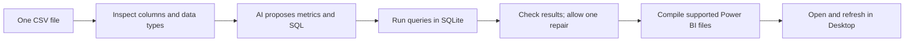

# Agentic BI Builder

I built a local workflow that turns a single data file into checked database queries and a Power BI project. An AI model proposes the business metrics; Python code executes the queries, checks the output and builds the report files.

This is a portfolio prototype developed under mentorship. It demonstrates how I connect uncertain AI output to predictable software checks. It is not a production analytics service, and I have not established general AI accuracy or measured business time savings.

## Try it in your browser

[Build a report in the public demo](https://tessa-agentic-bi-evidence.purple-tick-2127.chatgpt.site).

Use the 12 fictional sample invoices or upload your own CSV, then build and inspect a report. A CSV is a table stored as a text file. There are two modes:

- **Without a key:** the browser chooses a simple report plan and calculates it from your data. This is a deterministic simulation: the same input produces the same plan and results, without an AI call.
- **With your Gemini key:** Google proposes the metrics, then the browser checks the plan, calculates the results and builds the project. Your provider account's usage limits and charges apply. A failed online request is shown as an error; it is not silently replaced with a simulation.

Both modes download an editable Power BI Project (`.pbip`) ZIP, the actual input CSV and a run receipt containing the plan and calculated results. Extract the ZIP, save its `input.csv` at `C:\AgenticBIDemo\input.csv` (or change the file path in the included instructions), then open `BrowserDemo.pbip` in Windows Power BI Desktop and refresh. These are project source files, not a ready-made `.pbix` report. I have not freshly opened the browser-generated output in Desktop.

I built this browser version so someone can try the idea without installing Python or signing in to my service. It supports one table, four to eight metrics and a fixed set of calculations. It is a smaller implementation than the Python workflow below, rather than a browser port of its full AI review workflow. The sample is fictional data, not the Chinook dataset used by the local examples. The source repository is now public.

The CSV stays in your browser. Online planning sends Google your report goal and column metadata: names, types, missing-value counts, distinct-value counts and row count. It sends no row samples or minimum/maximum values. Column names and counts can still be sensitive. The key goes directly to Google in a request header, is never saved and is cleared after each run. See [browser-demo setup and limits](web-demo/README.md).

## The problem

Starting a business-intelligence report means inspecting a dataset, choosing useful measures, writing calculations and building the report structure. I wanted to explore which parts an AI-assisted workflow could handle while keeping its suggestions checkable.

## What I built

I implemented the workflow, its typed data contracts, query execution, report compiler and tests. A typed contract defines the fields and values each step must provide. The compiler converts supported query patterns into Power BI's report and data-model files. Unsupported calculations are rejected rather than guessed.

Mentor review and hardening contributions are retained in Git history. This is mentored individual implementation, not evidence that I wrote every supporting line without help.



This diagram describes the Python workflow. SQL is Structured Query Language, used to query the temporary SQLite database. LangGraph connects the workflow steps and limits the repair path to one retry; Pydantic checks the structured responses at step boundaries. The browser version asks for a restricted metric plan, not SQL, and calculates it directly in JavaScript.

## What the checks establish

The last full verified suite passed 264 tests with demo dependencies installed. A focused follow-up passed 30 demo and end-to-end tests after the public-evidence/provenance edits. These checks cover real query execution, rejected/accepted builds, report structure, workflow routing and command exit behavior. Provider calls in tests are mocked: controlled substitute responses exercise the software mechanics, not the model's quality.

The earlier fictional evidence export passed through the Python profiler, SQLite executor and report compiler. The interactive browser demo has its own local calculation and export implementation. Its 14 browser tests pass and exercise calculations, rejected plans and controlled provider responses. Generated ZIP contents and report JSON schemas were checked independently; browser testing covered sample/uploaded CSV builds, downloads and invalid-key handling. A browser-to-Google connection preflight was checked, but I have not verified a successful live generation using a valid visitor key. These checks do not establish AI metric quality or a fresh Power BI Desktop opening.

Historical AI-run artifacts are in [the evidence bundle](evidence/v1/README.md). They differ from deterministic replays and reconstructed fixtures. Provider/model identities were not retained for some historical runs, and the HR fixture is a reconstruction rather than saved provider output. Historical screenshots remain illustrations of their recorded runs; they are not new Desktop verification.

## Run locally

For the browser demo, serve the static files from the repository root:

```bash
python -m http.server 8000 --directory web-demo
```

Open `http://localhost:8000`. No backend or app-owned API key is needed. Online mode calls Google directly with the visitor's key. Hosting the full Python workflow on the same execution path would require a Python backend.

For the full Python workflow, supported versions are 3.10–3.12. The latest Windows verification used Python 3.12.0:

```bash
python -m venv .venv
# Activate the environment for your operating system.
python -m pip install -r requirements.txt
python -m pip install -r requirements-demo.txt
python -m pytest -q
python -m streamlit run app.py
```

The Streamlit app is a local web interface for the deterministic path: it uses stored metric specifications, executes their queries and compiles a downloadable project. It requires no API key. Base dependencies alone run 261 tests and skip the three optional interface tests; demo dependencies enable all 264.

To run the AI proposal/review steps, copy `.env.example` to `.env`, configure your Gemini or Mistral key, then run:

```bash
python run_agent.py --input data/raw/chinook.csv --output output/chinook_report
```

Live-provider calls require your provider account and may incur its normal usage charges.

## Scope and limits

- One table at a time; no joins between tables. Python SQL is validated for SQLite. The browser accepts supported metric operations rather than arbitrary queries.
- The Python report compiler supports a declared set of aggregate/query shapes and four visual types. A build with fewer than four usable visuals is rejected. The browser supports four to eight metrics using sum, average, count, minimum, maximum or distinct count, displayed as cards, bars, lines or tables.
- Proposed metrics must still make business sense. A valid query does not prove a useful metric or a reliable AI reviewer.
- Python metric generation receives column metadata; its review step receives sampled result rows. The whole Python live workflow is not metadata-only. The browser's online planner sends only the disclosed metadata and goal.
- Output is a Power BI Project (`.pbip`), a folder of report/model files. Windows and Power BI Desktop are needed to open it. The compiled model contains an absolute CSV path; relocate that path or keep the input at the documented location, then refresh. See the public example's explicit download instructions.
- No Power BI Service deployment, production adoption, multi-user service or general reflection-success rate is claimed.

For implementation details, see [the repository structure](STRUCTURE.md), [the compiler reference](docs/pbir_reference.md) and [the browser demo](web-demo/README.md). Portfolio audit/planning artifacts are archived in the professional-consolidation repository rather than this implementation tree.
